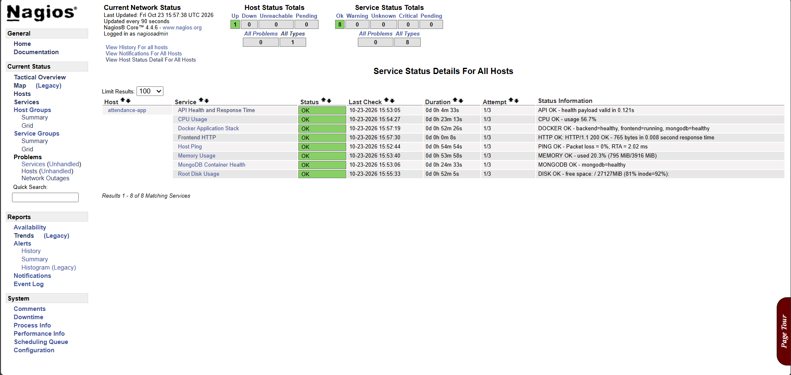
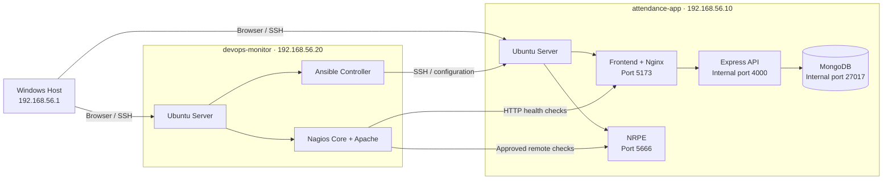
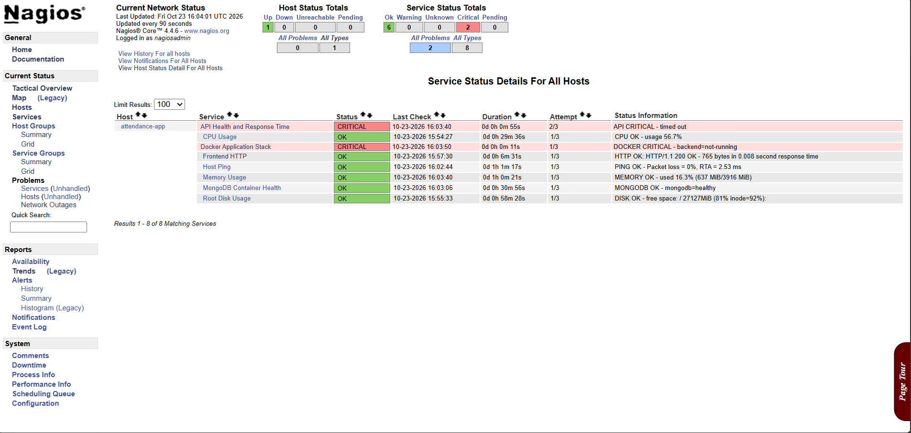

<div align="center">

# Student Attendance Tracker — DevOps Lab

**A reproducible two-VM deployment built around Ansible automation, Docker Compose, and Nagios monitoring.**

[](https://docs.ansible.com/)
[](https://docs.docker.com/compose/)
[](https://www.nagios.org/)
[](https://ubuntu.com/server)

<br>



<sub>Nagios healthy baseline: the application host is up and all eight project checks are OK.</sub>

</div>

---

## Overview

This Semester 7 project turns a full-stack attendance application into a practical DevOps laboratory. Two Ubuntu Server virtual machines divide application hosting from automation and monitoring:

- **Ansible** configures the target systems through reusable, idempotent roles.
- **Docker Compose** runs the React frontend, Express API, and MongoDB database.
- **Nagios Core + NRPE** monitor infrastructure, containers, HTTP availability, and API behaviour.
- **VirtualBox host-only networking** keeps management traffic isolated and gives both VMs stable addresses.

The project also includes a controlled failure demonstration: stopping the backend leaves the host and frontend reachable, while Nagios correctly marks the API and Docker stack as critical. Recreating the backend restores the complete healthy state.

## What this project demonstrates

| DevOps capability | Implementation |
| --- | --- |
| Configuration as code | Ansible inventories, variables, roles, templates, handlers, and playbooks |
| Repeatable deployment | Docker Engine and the application stack are installed without manual server drift |
| Idempotence | Repeated playbook runs complete with `changed=0` when the desired state already exists |
| Layered observability | Host, OS resources, containers, frontend, API, and MongoDB are checked independently |
| Failure isolation | Nagios distinguishes a backend outage from a complete VM outage |
| Secure local lab | Host-only access, authenticated Nagios CGIs, restricted NRPE clients, and external secrets |
| Documented recovery | Operational commands and recovery steps are included in the repository |

## Architecture



Both VMs also use a VirtualBox NAT adapter for outbound package and container-image downloads. All administration, application access, and monitoring traffic uses the isolated `192.168.56.0/24` host-only network.

### Nodes and endpoints

| Component | Address | Purpose |
| --- | --- | --- |
| Windows host | `192.168.56.1` | VirtualBox host, SSH client, and browser access |
| Application VM | `192.168.56.10` | Docker Engine and application containers |
| DevOps VM | `192.168.56.20` | Ansible controller, Nagios Core, and Apache |
| Application | `http://192.168.56.10:5173` | Student Attendance Tracker frontend |
| API health | `http://192.168.56.10:5173/api/v1/health` | Proxied API health endpoint |
| Nagios | `http://192.168.56.20/nagios4/` | Authenticated monitoring dashboard |

## Repository layout

```text
devops_sem7/
├── ansible/
│   ├── inventory/              # Hosts and group variables
│   ├── playbooks/              # Ordered automation entry points
│   └── roles/                  # Docker, application, NRPE, and Nagios roles
├── application/
│   ├── backend/                # Express, MongoDB, validation, tests
│   ├── frontend/               # React, TypeScript, Vite, Nginx
│   └── compose.yaml            # Three-service production stack
├── nagios/
│   ├── objects/                # NRPE command definitions
│   └── plugins/                # Custom CPU, memory, API, and Docker checks
├── docs/                       # Architecture, deployment, monitoring, and report
├── screenshots/                # Curated implementation evidence
└── README.md
```

## Ansible automation

The `devops-monitor` VM is the control node. It connects to `attendance-app` as the `app` user with an SSH key and escalates privileges only for tasks that require `sudo`.

### Roles

| Role | Responsibility |
| --- | --- |
| `docker` | Installs Docker Engine and the Compose plugin, manages group membership, and verifies the daemon |
| `application` | Deploys source files, creates protected runtime configuration, starts Compose, and verifies health |
| `monitoring_agent` | Installs NRPE and deploys the approved local monitoring commands |
| `nagios_server` | Installs Nagios/Apache, deploys plugins and objects, enables authentication, and verifies connectivity |

### Playbook order

```bash
cd ~/devops_sem7/ansible

ansible -i inventory/hosts.ini app_servers -m ping
ansible-playbook playbooks/install_docker.yml
ansible-playbook playbooks/deploy_application.yml
ansible-playbook playbooks/configure_monitoring_agent.yml
ansible-playbook playbooks/install_nagios.yml
```

> [!IMPORTANT]
> The application and monitoring VMs can use different sudo passwords. Run the application-targeting and local monitoring-server playbooks separately when prompted for the become password.

## Quick start

### 1. Prepare the virtual machines

Create two Ubuntu Server 24.04 VMs with one NAT adapter and one VirtualBox host-only adapter each.

| VM | Hostname | User | Host-only IP |
| --- | --- | --- | --- |
| Application | `attendance-app` | `app` | `192.168.56.10/24` |
| Automation/monitoring | `devops-monitor` | `devops` | `192.168.56.20/24` |

Install OpenSSH Server on both machines and confirm that Windows can connect to each host.

### 2. Configure controller access

On `devops-monitor`:

```bash
ssh-keygen -t ed25519
ssh-copy-id app@192.168.56.10
ssh app@192.168.56.10
```

### 3. Transfer the project to the controller

From Windows PowerShell at the repository root:

```powershell
scp -r .\ansible devops@192.168.56.20:~/devops_sem7/
scp -r .\application devops@192.168.56.20:~/devops_sem7/
scp -r .\nagios devops@192.168.56.20:~/devops_sem7/
```

### 4. Validate and deploy

```bash
cd ~/devops_sem7/ansible

ansible-playbook --syntax-check playbooks/install_docker.yml
ansible-playbook --syntax-check playbooks/deploy_application.yml
ansible-playbook --syntax-check playbooks/configure_monitoring_agent.yml
ansible-playbook --syntax-check playbooks/install_nagios.yml

ansible-playbook playbooks/install_docker.yml
ansible-playbook playbooks/deploy_application.yml
ansible-playbook playbooks/configure_monitoring_agent.yml
ansible-playbook playbooks/install_nagios.yml
```

### 5. Verify the deployment

```bash
curl -fsS http://192.168.56.10:5173/api/v1/health
/usr/lib/nagios/plugins/check_http -H 192.168.56.10 -p 5173
/usr/lib/nagios/plugins/check_nrpe -H 192.168.56.10 -t 20 -c check_cpu
/usr/lib/nagios/plugins/check_nrpe -H 192.168.56.10 -t 20 -c check_mongodb
```

The health endpoint should return:

```json
{"status":"ok","service":"student-attendance-tracker-api","version":1}
```

## Monitoring coverage

Nagios tracks eight project-specific services:

| Check | Mechanism | Healthy result |
| --- | --- | --- |
| Host Ping | ICMP | VM reachable with acceptable latency and packet loss |
| Frontend HTTP | `check_http` on port `5173` | HTTP `200 OK` |
| API Health and Response Time | Custom JSON/HTTP plugin | Valid payload within thresholds |
| CPU Usage | NRPE | Usage below warning and critical levels |
| Memory Usage | NRPE | Usage below warning and critical levels |
| Root Disk Usage | NRPE | Sufficient free disk space |
| Docker Application Stack | Custom NRPE plugin | Frontend, backend, and MongoDB healthy |
| MongoDB Container Health | Custom NRPE plugin | MongoDB container healthy |

NRPE binds to `192.168.56.10:5666` and permits only `127.0.0.1`, `::1`, and `192.168.56.20`.

## Failure and recovery demonstration

Stop the backend on `attendance-app`:

```bash
cd /opt/student-attendance-tracker
docker compose stop backend
docker compose ps
```

Expected monitoring behaviour:

- Host Ping, Frontend HTTP, CPU, memory, disk, and MongoDB remain **OK**.
- API Health and Docker Application Stack become **CRITICAL**.

Recover the service:

```bash
docker compose up -d backend
docker compose restart frontend
curl -fsS http://192.168.56.10:5173/api/v1/health
```

The frontend restart refreshes Nginx's upstream resolution after the backend container is recreated.

## Evidence

<table>
  <tr>
    <td align="center"><br><sub>Ansible Docker role: 0 changes on the second run</sub></td>
    <td align="center"><br><sub>Application deployment and health verification</sub></td>
  </tr>
  <tr>
    <td align="center"><br><sub>Nagios detects the controlled backend failure</sub></td>
    <td align="center"><br><sub>All eight checks restored to OK</sub></td>
  </tr>
</table>

## Security notes

- Runtime `.env` files, generated passwords, private keys, and Ansible vault files are ignored by Git.
- The Nagios administrator password is generated on `devops-monitor` and stored at `~/.ansible/nagios/admin_password`.
- Nagios command CGIs require authentication; anonymous commands are not enabled.
- Backend and MongoDB ports are not published to the Windows host.
- This lab uses HTTP only on an isolated host-only network, so `SESSION_COOKIE_SECURE=false` is intentional.
- Any public deployment must add TLS and set `SESSION_COOKIE_SECURE=true`.

> [!CAUTION]
> Never commit the generated application `.env`, Nagios password file, SSH private keys, database dumps, or VM disk images.

## Application development

The application is a Node.js workspace containing a React frontend and Express backend.

```bash
cd application
npm ci
npm run lint
npm test
npm run build
```

For application features and local development details, see [`application/README.md`](application/README.md).

## Documentation

- [System architecture](docs/architecture.md)
- [Application deployment guide](docs/deployment-guide.md)
- [Nagios monitoring guide](docs/monitoring-guide.md)
- [Demonstration script](docs/demo-script.md)
- [VM setup and recovery guide](docs/Application_VM_Setup_and_Recovery_Guide.docx)
- [Project report](docs/report.docx)

## Technology stack

| Layer | Technology |
| --- | --- |
| Automation | Ansible |
| Monitoring | Nagios Core, NRPE, custom Python plugins |
| Containers | Docker Engine, Docker Compose |
| Frontend | React 19, TypeScript, Vite, Nginx |
| Backend | Node.js, Express 5, Zod, Mongoose |
| Database | MongoDB 8 |
| Infrastructure | VirtualBox, Ubuntu Server 24.04 |

---

<div align="center">

**DevOps Semester 7 · Student Attendance Tracker**

Built to demonstrate automation, observability, repeatability, and recovery in a self-contained local environment.

</div>

